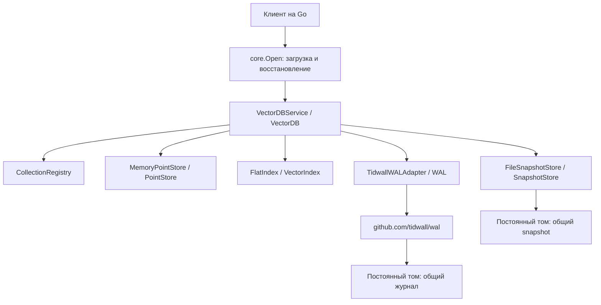

# Учебная векторная база данных на Go

Локальная БД принимает готовые векторы, текст и метаданные. Поддерживает несколько коллекций, точный поиск, частичные обновления, связи родителей и каскадное удаление.
Рабочие данные находятся в памяти. Общий WAL и JSON snapshot сохраняются на диске и восстанавливают состояние при открытии.

## Краткий отчёт по ЛР‑2

**Цель:** реализовать локальную векторную БД на Go на основе интерфейсов ЛР‑1.

**Результат:** добавлены коллекции, операции с точками, фильтрация метаданных и точный поиск с метриками COSINE, DOT и L2. Для хранения используются память, общий журнал WAL и snapshot; при открытии предусмотрено восстановление состояния и перестроение индексов.

## Архитектура

Предусмотренный контракт записи: проверка всей пачки под блокировкой → WAL → `fsync` → память → индекс → ответ. 
Поиск: проверка запроса → фильтр метаданных → полный перебор разрешённых векторов → сортировка → TopK.
Восстановление: snapshot → записи WAL после `LastLSN` → перестроение индексов.

## Код и документация

| Путь | Назначение |
|---|---|
| `internal/model` | Данные, ошибки, копирование и проверка значений |
| `internal/ports` | Контракты хранения, поиска, WAL и snapshot |
| `internal/core` | Публичный интерфейс и конструктор БД |
| `internal/core/service` | Коллекции, операции, replay, checkpoint и Close |
| `internal/storage` | Хранилище в памяти и фильтры |
| `internal/index` | FlatIndex, cosine, dot product и L2 |
| `internal/persistence` | Адаптер tidwall/wal, JSON версии 1 и CRC32C, snapshot |
| `cmd/demo` | Запускаемый пример  |

- [Контракты и диаграммы ЛР‑1](docs/lab1/interfaces.md), [реализации ЛР‑2](docs/lab2/interfaces.md).

