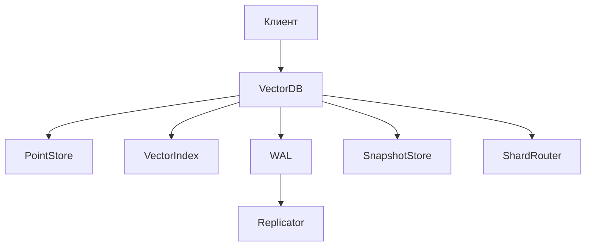

# Учебная векторная база данных

Проект развивается последовательно в пяти лабораторных работах.

1. ЛР‑1: модели, интерфейсы и диаграммы.
2. ЛР‑2: локальное хранение, WAL, snapshot и точный поиск.
3. ЛР‑3: REST API.
4. ЛР‑4: асинхронная репликация.
5. ЛР‑5: шардирование.

## Как работает БД

По проектному контракту клиент передаёт в БД готовые векторы вместе с текстом и метаданными. При записи `VectorDB` проверяет коллекцию, размерность вектора, метаданные и связи с родителем, выбирает шард по `PartitionKey`, фиксирует операцию в WAL, а затем обновляет хранилище и векторный индекс. Поиск выполняется глобально по коллекции: сначала можно отобрать кандидатов по метаданным, затем индекс находит ближайшие векторы, а хранилище дополняет результаты текстом и метаданными.

## Как устроен проект
Проект собран как модульный монолит: `internal/model` задаёт общие типы данных и ошибок, `internal/core` описывает публичный интерфейс `VectorDB`, а `internal/ports` содержит контракты хранилища, индекса, WAL, snapshot, шардирования и репликации.  В ЛР‑1 эти компоненты пока представлены только типами и интерфейсами; работающие алгоритмы будут добавляться в следующих лабораторных.

## Схема компонентов

## Структура ЛР‑1

- `internal/model` — структуры данных и ошибки;
- `internal/core` — основной интерфейс `VectorDB`;
- `internal/ports` — интерфейсы хранилища, индекса, WAL, snapshot, шардирования и репликации;
- `docs/lab1/interfaces.md` — графическое представление архитектуры.
