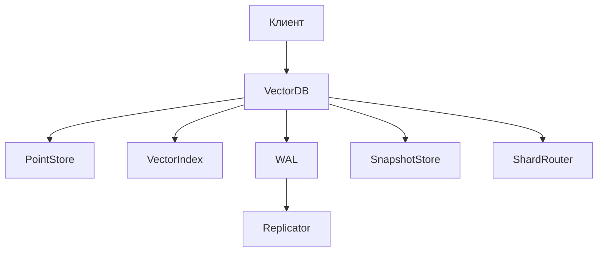
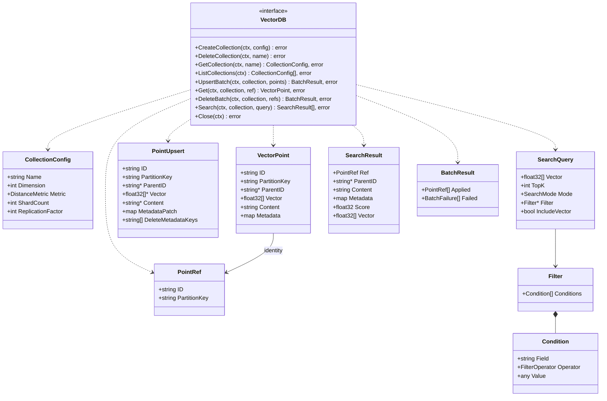
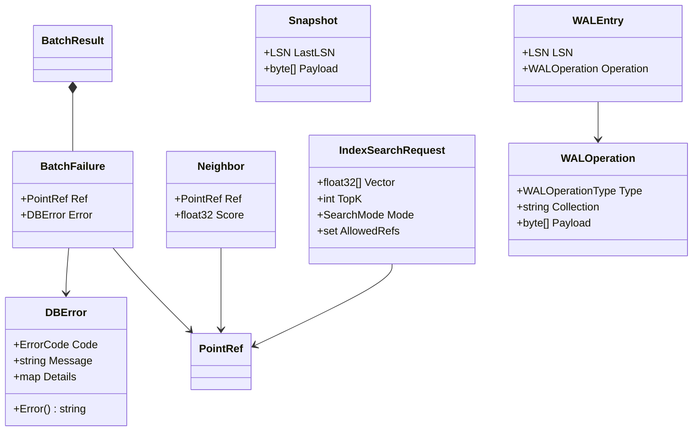
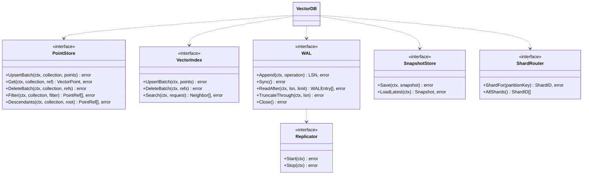

# Интерфейсы векторной БД

## Компоненты

`VectorDB` координирует сценарии, а остальные интерфейсы изолируют способы хранения, поиска, восстановления и распределения данных.

## Основные типы и интерфейсы

## Вспомогательные структуры

## Именованные типы

| Тип | Значения или назначение |
|---|---|
| `DistanceMetric` | `COSINE`, `DOT`, `L2` |
| `SearchMode` | `EXACT`, `APPROXIMATE` |
| `FilterOperator` | `EQ`, `GT`, `GTE`, `LT`, `LTE` |
| `ErrorCode` | стабильные машинные коды ошибок БД |
| `WALOperationType` | тип операции, записанной в WAL |
| `LSN` | монотонный номер записи WAL |
| `ShardID` | идентификатор шарда |

## Внутренние порты

## Важные правила

- Корень использует `PartitionKey = ID`; его потомки передают тот же `PartitionKey`.
- Пустой `SearchMode` трактуется сервисом как `EXACT`.
- ЛР‑1 фиксирует контракты, но не реализует алгоритмы.
