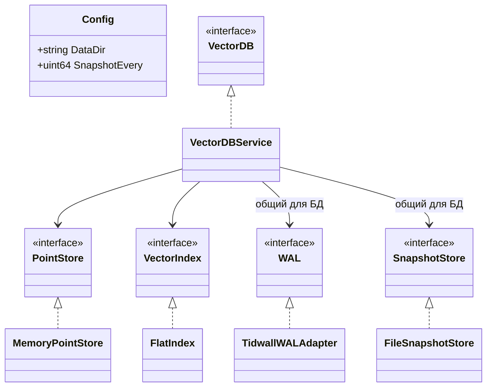

# Реализация ЛР‑2

`Open` создаёт адаптеры и сервис, загружает snapshot и WAL, строит индексы и возвращает `VectorDB`.
`Config.DataDir` обязателен; `SnapshotEvery = 0` выбирает 1000 операций.
Один каталог использует один экземпляр БД.

Методы коллекций, `UpsertBatch`, `Get`, `DeleteBatch`, `Search` и `Close` реализованы в отдельных файлах `internal/core/service`. Публичные `core.Open`, `core.Config` и `core.VectorDB` остаются в `internal/core`.
Число коллекций может быть больше одного, но WAL, его последовательность LSN и snapshot общие для локальной БД.
